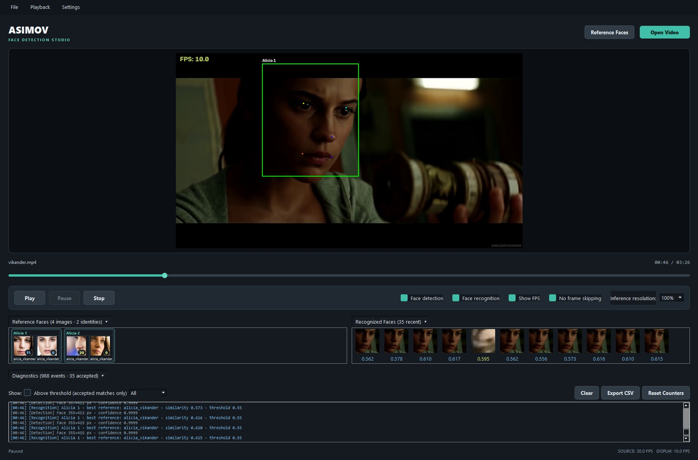

# ASIMOV

**ASIMOV** is an experimental face detection and recognition project built with Python, TensorFlow, RetinaFace, and ArcFace. It provides a reusable inference API and **Asimov Studio**, a desktop application for exploring video-based face detection, reference-image matching, and recognition diagnostics.

The project is under active development. Its emphasis is on transparent experimentation: inspecting individual recognition results, comparing reference photographs, and building reproducible performance benchmarks rather than treating a match as definitive identification.

## Overview

ASIMOV separates two stages of the pipeline:

- **RetinaFace** detects faces and their landmarks in an image or video frame.
- **ArcFace** produces facial embeddings that can be compared with embeddings from registered reference images.

The `API` class in `application.core.API` exposes the core operations:

| Method | Purpose |
| --- | --- |
| `detect_faces(frame, draw_bounding_box)` | Detect faces and optionally annotate the input image |
| `recognize_faces(image)` | Generate an embedding for a face crop |
| `compare_faces(first_crop, second_crop)` | Compare two face crops |

Model paths and other settings are configured in `Settings.py`. The application currently uses TensorFlow for inference and PyQt5 for the desktop interface.

## Asimov Studio

**Asimov Studio** is the graphical workspace for experimenting with face recognition in video. It combines playback, reference management, live matching, and detailed diagnostics in one interface.



### Using the studio

1. **Start the application.** Run the project's `GUI.py` entry point from the configured Python environment.
2. **Register reference faces.** Select **Reference Faces** → **Add Images**. ASIMOV detects usable faces and registers their embeddings. The initial label comes from each image's filename, without its extension.
3. **Manage references.** Edit labels, include or exclude individual images, and select rows to assign several references to a shared identity. Reference photographs retain their own labels and match counters.
4. **Open a video.** Select **Open Video** and choose a supported video file. Use the playback buttons or click the video itself to pause and resume. The timeline supports seeking.
5. **Enable inference.** Turn on **Face detection** to display bounding boxes and landmarks. Enable **Face recognition** to compare detected faces with included references and display accepted identity matches.
6. **Inspect results.** Expand **Reference Faces** to see grouped reference images and their counters. Expand **Recognized Faces** to view a rolling strip of accepted face crops and similarity scores. The oldest crops disappear as the strip fills.
7. **Review diagnostics.** Expand **Diagnostics** to filter detection and recognition events, inspect scores, reset match counters, or export events to CSV.

### Video and inference controls

| Control | Behavior |
| --- | --- |
| **Face detection** | Enables RetinaFace detection and on-video annotations |
| **Face recognition** | Enables comparison against included reference embeddings; also enables detection |
| **Show FPS** | Displays the measured video display rate |
| **No frame skipping** | Processes frames sequentially instead of skipping ahead to maintain playback timing |
| **Inference resolution** | Runs inference at 100%, 75%, 50%, or 25% of the source frame dimensions while retaining the full-resolution video display |

Recognition currently uses a similarity threshold of **0.55** and a **0.04** margin over the next-best identity when more than one identity competes. These values are experimental, not validated operating thresholds.

**Current limitations:** Reference images, identity assignments, and rolling face crops are session-only; they are not persisted when the application closes. Recognition can produce false positives, particularly with challenging poses or visually similar faces. The FPS overlay measures display performance and should not be interpreted as a controlled model benchmark.

## Quickstart

Clone the repository:

```bash
git clone https://github.com/JamesPiggott/ASIMOV.git
cd ASIMOV
```

Create a virtual environment and install the repository's dependencies:

```bash
python -m venv .venv
```

On Windows PowerShell:

```powershell
.venv\Scripts\Activate.ps1
python -m pip install -r requirements.txt
```

On Linux or macOS:

```bash
source .venv/bin/activate
python -m pip install -r requirements.txt
```

Launch Asimov Studio from the repository's configured working directory:

```bash
python GUI.py
```

The models must be present at the locations expected by `Settings.py`. If your checkout uses Git LFS for model files, install Git LFS and run `git lfs pull` after cloning.

**Environment note:** Development has been exercised on Windows 11 with Python 3.13 and TensorFlow 2.20 using CPU inference. This is not yet a tested cross-platform installation matrix; verify the repository's dependency pins and model paths for your system. Native Windows CUDA acceleration is not provided by the standard recent TensorFlow pip builds; GPU benchmarking will require a separately validated setup.

### API example

```python
import cv2
from application.core.API import API

image = cv2.imread("example.jpg")
api = API()

# Detect faces and request an annotated result.
result = api.detect_faces(image, True)

# Each detected face can provide a crop for embedding generation.
for face in result.faces:
    crop = face.get_crop()
    if crop is not None and crop.size:
        embedding = api.recognize_faces(crop)
```

## Testing and experiments

The repository includes scripts for exercising the models outside the GUI. Depending on the checkout, these include `video_detection_test.py`, `webcam_test.py`, `image_recognition_test.py`, and `face_recognition_test.py`.

These utilities are useful for isolating detection, recognition, and embedding comparisons from the video interface. Automated regression coverage and repeatable benchmark runs remain areas for improvement.

## Project status and roadmap

**Status: Active experimental development — November 2026.** The core models load and run in the current development environment, and Asimov Studio supports interactive video recognition and inspection.

**Implemented**

- RetinaFace detection and ArcFace embedding integration
- Video playback with bounding boxes, landmarks, seeking, and FPS display
- Reference image import, labeling, inclusion/exclusion, and match counters
- Manual grouping of reference images into identities
- Rolling gallery of accepted recognition crops and similarity scores
- Filterable diagnostics with CSV export
- Sequential/no-skip playback and selectable inference resolution

**Planned / under consideration**

- **Persistent reference library:** Save reference images, embeddings, identity assignments, and settings between sessions
- **CPU and GPU benchmarking:** Measure detection time, recognition time, end-to-end throughput, and processed/skipped frames using repeatable test inputs
- **Recognition evaluation:** Investigate false positives, image pose, lighting, reference quality, thresholds, and identity-level decisions
- **Identity management:** Refine grouping, editing, and reference-level comparison tools
- **Automated tests:** Add regression tests for API behavior, GUI workflows, and inference outputs
- **Model experimentation:** Evaluate alternative detection and recognition models against consistent test sets

Roadmap items are development directions, not implemented features or release commitments.

## Hardware and dependencies

ASIMOV uses Python, TensorFlow 2, OpenCV, NumPy, PyQt5, RetinaFace, and ArcFace models. Actual CPU/GPU performance depends on the hardware, runtime, model configuration, inference resolution, and input video.

GPU support requires an appropriate operating system, drivers, TensorFlow build, and acceleration libraries. See the [official TensorFlow installation guide](https://www.tensorflow.org/install/pip) for current requirements. ASIMOV does not yet publish verified comparative CPU/GPU benchmark results.

## Research and acknowledgements

The implementation builds on work from the RetinaFace and ArcFace research communities, including:

- [RetinaFace for TensorFlow 2](https://github.com/peteryuX/retinaface-tf2)
- [ArcFace for TensorFlow 2](https://github.com/peteryuX/arcface-tf2)

Credit belongs to the researchers and open-source maintainers behind these components. Review the applicable model, weight, and dependency licenses before redistribution or deployment.

## Contributing

ASIMOV is a research-oriented project. Contributions relating to compatibility, reproducible testing, performance, documentation, and responsible evaluation are welcome.

## Disclaimer

ASIMOV is experimental software, **not a production-ready biometric identification system**. Recognition results can be affected by pose, image quality, illumination, demographic variation, training data, and decision thresholds. A similarity score or accepted match is not definitive proof of identity.

Use involving real people or biometric data must account for consent, privacy, security, and applicable law. Do not use ASIMOV for consequential identification or surveillance without appropriate independent validation and safeguards.
